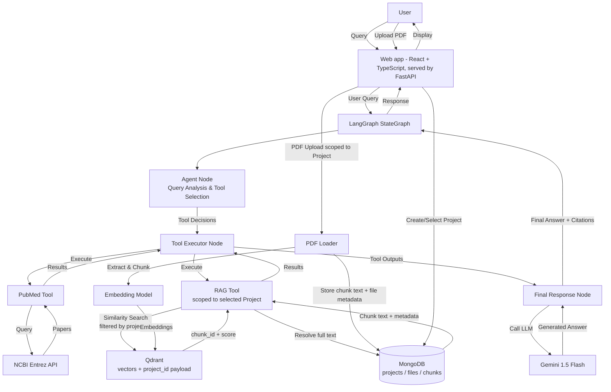

# 🏥 Smart Medical Assistant

An intelligent agentic RAG (Retrieval-Augmented Generation) system that answers medical questions by autonomously deciding whether to search recent medical research papers from PubMed, retrieve information from locally uploaded medical PDFs, or combine both sources.

**⚠️ DISCLAIMER**: This tool is for educational and informational purposes only and does not constitute medical advice. Always consult qualified healthcare professionals for medical decisions, diagnoses, or treatment plans.

## Features

- **🤖 Intelligent Agent**: Automatically selects appropriate information sources based on query analysis
- **📚 PubMed Integration**: Searches recent medical research papers from NCBI PubMed database
- **📄 Local RAG**: Searches uploaded medical PDF documents using vector similarity
- **🔄 Hybrid Search**: Combines both sources when comprehensive answers are needed
- **🎯 Smart Citations**: Distinguishes between PubMed papers and local documents with proper attribution
- **💬 Web App ("Pulse")**: React + TypeScript site with live progress ("searching your documents / PubMed"), an evidence panel for every answer, drag & drop PDFs, Arabic/RTL and dark mode
- **🔒 Medical Safety**: Built-in guardrails for uncertainty handling and appropriate disclaimers

## Architecture



## Technology Stack

- **Workflow Orchestration**: LangGraph StateGraph
- **Language Model**: Google Gemini 1.5 Flash
- **Vector Database**: Qdrant (embeddings, filtered per project)
- **Metadata & Content Storage**: MongoDB (projects, file metadata, chunk text)
- **Embeddings**: sentence-transformers/all-MiniLM-L6-v2
- **Medical Research API**: NCBI PubMed (via Biopython)
- **User Interface**: React 18 + TypeScript + Vite (`web/`), served by a FastAPI JSON API (`api/`)
- **Document Processing**: PyPDF2 with RecursiveCharacterTextSplitter

## Prerequisites

- **Python**: 3.9 or higher
- **MongoDB**: a running instance (local or Atlas)
- **Qdrant**: a running instance (local or Qdrant Cloud)
- **API Keys**:
  - Google Gemini API key ([Get it here](https://makersuite.google.com/app/apikey))
  - NCBI email (required for PubMed API)
  - NCBI API key (optional, for higher rate limits)

### Running MongoDB and Qdrant locally with Docker

```bash
docker run -d -p 27017:27017 --name mongo mongo:7
docker run -d -p 6333:6333 --name qdrant qdrant/qdrant
```

## Quick Start

### 1. Clone Repository

```bash
git clone <repository-url>
cd smart-medical-assistant
```

### 2. Install Dependencies

```bash
# Create virtual environment (recommended)
python -m venv venv

# Activate virtual environment
# On Linux/Mac:
source venv/bin/activate
# On Windows:
venv\Scripts\activate

# Install dependencies
pip install -r requirements.txt
```

### 3. Configure Environment

```bash
# Copy environment template
cp .env.example .env

# Edit .env and add your API keys
```

Required environment variables in `.env`:
```env
LLM_PROVIDER=cohere
COHERE_API_KEY=your_cohere_api_key_here
LLM_MODEL=command-a-03-2025
GEMINI_API_KEY=
NCBI_EMAIL=                      # Optional fallback; users enter email in the UI
NCBI_API_KEY=your_ncbi_api_key_here  # Optional

MONGO_URI=mongodb://localhost:27017
MONGO_DB_NAME=medical_assistant

QDRANT_URL=http://localhost:6333
QDRANT_API_KEY=                      # Optional, for Qdrant Cloud
QDRANT_COLLECTION_NAME=medical_chunks
```

### 4. Build the web front-end (once, and after changing `web/`)

Requires Node.js 18+.

```bash
cd web
npm install
npm run build
```

### 5. Run Application

```bash
python app.py
```

Open http://localhost:7860. The server binds to `127.0.0.1` by default; set `APP_HOST=0.0.0.0` to expose it on your network.
Set `APP_SECRET` in `.env` to keep people signed in across restarts.

### Front-end development (hot reload)

Run `python app.py` in one terminal and the Vite dev server in another; it proxies `/api` to the Python server:

```bash
cd web
npm run dev
```

Then open http://localhost:5173.

## Usage Guide

### Projects (Workspaces)

Every document and every RAG query is scoped to a **project**:

1. Use the workspace switcher at the top of the left sidebar (every account starts with "My first workspace")
2. Create a new workspace from the same menu, or delete one (with its documents and conversations)
3. Upload PDFs and ask questions — both are scoped to the selected workspace
4. Each workspace has its own isolated set of documents/chunks (Qdrant search results are filtered by `project_id` and `user_id`, and MongoDB stores each workspace's files/chunks separately)

### Asking Questions

The agent automatically selects the appropriate information source based on your query:

#### PubMed-Only Queries
Questions about recent research, latest studies, or published findings:
```
"What are the latest diabetes treatment guidelines published in 2023?"
"Recent research on COVID-19 vaccine efficacy"
"What do current studies say about hypertension medication?"
```

#### Local Document Queries
Questions about uploaded documents or organizational protocols:
```
"What does our hospital protocol say about patient admission?"
"According to the uploaded guidelines, what are the discharge criteria?"
"Summarize our diabetes management protocol"
```

#### Hybrid Queries
Questions requiring both sources:
```
"How does our diabetes protocol compare to recent research?"
"Are our treatment guidelines aligned with latest published studies?"
"Update recommendations based on 2023 research and our current protocols"
```

#### General Medical Queries
Basic medical knowledge questions:
```
"What is hypertension?"
"Explain how insulin works"
"What are the symptoms of pneumonia?"
```

### Uploading PDFs

1. Open the **Library** tab in the right panel
2. Drop PDFs onto it (or click to browse) - several at once is fine
3. A progress bar shows the upload, then "Reading & indexing pages…"
4. Uploading a file with the same name replaces the previous copy; the trash icon removes a document

### Citations

Citations appear as coloured chips inside the answer (teal = your documents, violet = PubMed), and the
**Evidence** panel lists every page and paper the answer used, with relevance scores and PubMed links.
Answers that needed no search say so - the model is instructed never to invent references.

Format used by the model:
- **PubMed papers**: `[Title, Journal, Publication Date]`
- **Local documents**: `[Filename, Page X]`
- **Relevance scores**: Included for local document citations

## Project Structure

```
smart-medical-assistant/
├── app.py                    # Main application entry point
├── config/                   # Configuration management
│   ├── settings.py          # Pydantic settings with validation
│   └── logging_config.py    # Logging configuration
├── graph/                    # LangGraph workflow components
│   ├── state.py             # State schema (TypedDict)
│   ├── nodes.py             # Agent & final response nodes
│   └── workflow.py          # StateGraph construction
├── tools/                    # Tool implementations
│   ├── pubmed_tool.py       # PubMed search tool
│   ├── rag_tool.py          # Local RAG search tool
│   └── pdf_loader.py        # PDF processing and ingestion
├── prompts/                  # Prompt templates
│   ├── system_prompt.py     # System-level instructions
│   └── routing_prompt.py    # Agent routing logic
├── api/                      # FastAPI JSON API + static hosting of web/dist
│   ├── server.py            # Routes (auth, workspaces, files, conversations, streaming chat)
│   └── sessions.py          # Signed httpOnly session cookie
├── web/                      # React + TypeScript front-end ("Pulse")
│   ├── src/App.tsx          # App state and data flow
│   ├── src/components/      # Sidebar, Chat, EvidencePanel, AuthScreen, ...
│   └── src/styles.css       # Design system (light + dark)
├── src/                      # Controllers, services (assistant, citations, documents), stores
├── ui/                       # Legacy Gradio interface (no longer started by app.py)
├── db/                       # MongoDB and Qdrant data-access clients
├── tests/                    # Regression tests
│   └── test_pdf_loader.py
├── logs/                     # Application logs
│   └── app.log              # (created on startup)
├── requirements.txt          # Runtime dependencies
├── requirements-dev.txt      # Test/development dependencies
├── .env.example             # Environment variable template
└── README.md                # This file
```

## Configuration

### Required Environment Variables

| Variable | Description | Required |
|----------|-------------|----------|
| `COHERE_API_KEY` | Cohere API key | Yes when `LLM_PROVIDER=cohere` |
| `GEMINI_API_KEY` | Google Gemini API key | Yes when `LLM_PROVIDER=gemini` |
| `NCBI_EMAIL` | Optional fallback; users normally enter email in the UI | No |
| `NCBI_API_KEY` | NCBI API key (higher rate limits) | No |

### Optional Configuration

All parameters have sensible defaults but can be overridden in `.env`:

| Variable | Default | Description |
|----------|---------|-------------|
| `EMBEDDING_MODEL` | sentence-transformers/all-MiniLM-L6-v2 | Embedding model |
| `LLM_PROVIDER` | cohere | LLM provider (`cohere` or `gemini`) |
| `LLM_MODEL` | command-a-03-2025 | Chat model name |
| `LLM_TEMPERATURE` | 0.1 | Generation temperature (0.0-2.0) |
| `CHUNK_SIZE` | 1000 | Text chunk size |
| `CHUNK_OVERLAP` | 200 | Chunk overlap |
| `TOP_K` | 5 | Number of results to retrieve |
| `SCORE_THRESHOLD` | 0.2 | Minimum relevance score (0.0-1.0) |
| `QDRANT_URL` | http://localhost:6333 | Qdrant server URL |
| `QDRANT_COLLECTION_NAME` | medical_chunks | Qdrant collection name |
| `LOG_FILE` | ./logs/app.log | Log file path |

## Troubleshooting

### Configuration Errors

**Error**: "Configuration error: field required"
```bash
# Solution: Ensure required variables are set in .env
cp .env.example .env
# Edit .env and add COHERE_API_KEY and NCBI_EMAIL
```

**Error**: "NCBI_EMAIL must be a valid email address"
```bash
# Solution: Use a real email address with @ symbol
NCBI_EMAIL=                      # Optional fallback; users enter email in the UI
```

### Import Errors

**Error**: "ModuleNotFoundError"
```bash
# Solution: Install all dependencies
pip install -r requirements.txt
```

### API Errors

**Error**: "PubMed API error" or "Unable to reach PubMed"
```bash
# Check internet connection
# Verify NCBI_EMAIL is set correctly
# Optional: Add NCBI_API_KEY for higher rate limits
```

**Error**: "Gemini API error"
```bash
# Verify GEMINI_API_KEY is correct
# Check API key has not expired
# Ensure you have API credits/quota available
```

### PDF Processing Errors

**Error**: "Unable to read PDF. File may be corrupted or encrypted"
```bash
# Solution: PDF may be encrypted or corrupted
# Try a different PDF file
# Ensure PDF contains extractable text (not scanned images)
```

## Development

### Running Tests

```bash
# Install test dependencies
pip install -r requirements-dev.txt

# Run the regression suite
python -m pytest
```

The regression suite does not require live MongoDB, Qdrant, PubMed, or Gemini
credentials. Full end-to-end verification additionally requires the services
and environment variables described in the Quick Start section.

### Logging

Logs are written to both console and `./logs/app.log` with structured format:
```
2024-01-15 10:23:45 - module_name - INFO - Log message
```

Log levels:
- **INFO**: Normal operations
- **WARNING**: Recoverable issues
- **ERROR**: Failures preventing operation

## Deployment

### Local Deployment

1. Follow Quick Start instructions
2. Build the front-end: `cd web && npm install && npm run build`
3. Run `python app.py`
4. Access at http://localhost:7860

### Production Deployment

#### Using Docker (Recommended)

```dockerfile
FROM python:3.10-slim

WORKDIR /app

COPY requirements.txt .
RUN pip install --no-cache-dir -r requirements.txt

COPY . .

EXPOSE 7860

CMD ["python", "app.py"]
```

Build and run:
```bash
docker build -t smart-medical-assistant .
docker run -p 7860:7860 --env-file .env smart-medical-assistant
```

#### Security Considerations

1. **API Key Management**:
   - Never commit `.env` to version control
   - Use secrets management (AWS Secrets Manager, HashiCorp Vault)
   - Rotate keys regularly

2. **Access Control**:
   - Deploy behind authentication proxy
   - Use HTTPS with valid SSL certificate
   - Implement rate limiting

3. **Data Privacy**:
   - Uploaded PDFs may contain sensitive medical data
   - Store vector database on encrypted volumes
   - Implement data retention policies

4. **Resource Requirements**:
   - CPU: 4+ cores
   - RAM: 8+ GB
   - Disk: 10+ GB (for vector store and logs)

## License

[Your License Here]

## Contributing

[Contribution Guidelines]

## Support

For issues and questions:
- Check Troubleshooting section above
- Review logs in `./logs/app.log`
- Run the offline checks with `python -m pytest`

## Acknowledgments

- **LangChain & LangGraph**: Workflow orchestration
- **Google Gemini**: Language model
- **NCBI PubMed**: Medical research database
- **Qdrant**: Vector storage
- **Gradio**: User interface framework


## Deployment Guide

### Cloud Platform Options

#### AWS Deployment

**Using EC2**:
1. Launch EC2 instance (t3.medium or larger)
2. Install Python 3.9+
3. Clone repository and install dependencies
4. Configure security group (port 7860)
5. Use systemd service for auto-restart

```bash
# Create systemd service file
sudo nano /etc/systemd/system/medical-assistant.service
```

```ini
[Unit]
Description=Smart Medical Assistant
After=network.target

[Service]
Type=simple
User=ubuntu
WorkingDirectory=/home/ubuntu/smart-medical-assistant
Environment="PATH=/home/ubuntu/smart-medical-assistant/venv/bin"
ExecStart=/home/ubuntu/smart-medical-assistant/venv/bin/python app.py
Restart=always

[Install]
WantedBy=multi-user.target
```

```bash
sudo systemctl enable medical-assistant
sudo systemctl start medical-assistant
```

**Using ECS with Fargate**:
1. Build and push Docker image to ECR
2. Create ECS task definition
3. Mount EFS volume for vector store persistence
4. Configure ALB for HTTPS access
5. Set environment variables via AWS Secrets Manager

#### Google Cloud Platform

**Using Cloud Run**:
1. Build container image
2. Push to Google Container Registry
3. Deploy to Cloud Run with persistent disk
4. Configure Cloud Load Balancer
5. Use Secret Manager for API keys

```bash
gcloud run deploy medical-assistant \
  --image gcr.io/PROJECT_ID/medical-assistant \
  --platform managed \
  --region us-central1 \
  --allow-unauthenticated \
  --memory 4Gi \
  --cpu 2
```

#### Azure

**Using Azure Container Instances**:
1. Build and push image to Azure Container Registry
2. Create Azure Files share for vector store
3. Deploy container instance with volume mount
4. Configure Application Gateway for SSL
5. Use Azure Key Vault for secrets

### Environment Variables for Production

```env
# Required
GEMINI_API_KEY=<from-secrets-manager>
NCBI_EMAIL=ops@yourorg.com
NCBI_API_KEY=<from-secrets-manager>

# Production overrides
LLM_TEMPERATURE=0.05
TOP_K=10
CHUNK_SIZE=1200
CHUNK_OVERLAP=300
QDRANT_URL=https://your-qdrant-host
QDRANT_COLLECTION_NAME=medical_chunks
LOG_FILE=/var/log/medical-assistant/app.log
```

### Monitoring and Observability

#### Application Metrics

Track key metrics:
- Request latency (p50, p95, p99)
- Error rate by error type
- Tool usage distribution (PubMed vs RAG vs both)
- Vector store size and query latency
- API quota usage (Gemini, PubMed)

#### Logging

Configure centralized logging:
- **AWS**: CloudWatch Logs
- **GCP**: Cloud Logging (Stackdriver)
- **Azure**: Application Insights
- **On-Premise**: ELK Stack or Splunk

#### Health Checks

Add health check endpoint for orchestrators:

```python
# Add to app.py for production
@app.route("/health")
def health_check():
    return {"status": "healthy", "timestamp": datetime.now().isoformat()}
```

### Scaling Considerations

1. **Horizontal Scaling**:
   - Deploy multiple instances behind load balancer
   - Use shared network storage (EFS, Cloud Filestore) for vector store
   - Implement Redis for PubMed query caching across instances

2. **Vertical Scaling**:
   - Increase CPU for faster embedding generation
   - Increase RAM for larger vector store in memory
   - Use GPU instances for faster embeddings (optional)

3. **Rate Limiting**:
   - Implement per-user rate limits
   - Queue requests during high load
   - Cache frequent queries

### Backup and Recovery

1. **Database Backup**:
```bash
# Back up MongoDB and use Qdrant snapshots according to your deployment
mongodump --uri "$MONGO_URI" --db "$MONGO_DB_NAME" --archive | gzip > mongo-backup-$(date +%Y%m%d).archive.gz
```

2. **Configuration Backup**:
- Store `.env` in secrets manager
- Version control all code
- Document manual configuration steps

### SSL/TLS Configuration

For production, use HTTPS:

**Using Nginx Reverse Proxy**:
``
ginx
server {
    listen 443 ssl;
    server_name medical-assistant.yourorg.com;
    
    ssl_certificate /etc/letsencrypt/live/yourorg.com/fullchain.pem;
    ssl_certificate_key /etc/letsencrypt/live/yourorg.com/privkey.pem;
    
    location / {
        proxy_pass http://localhost:7860;
        proxy_set_header Host $host;
        proxy_set_header X-Real-IP $remote_addr;
        proxy_set_header X-Forwarded-For $proxy_add_x_forwarded_for;
        proxy_set_header X-Forwarded-Proto $scheme;
    }
}
```

**Using Caddy (Automatic HTTPS)**:
```caddyfile
medical-assistant.yourorg.com {
    reverse_proxy localhost:7860
}
```

### Performance Optimization

1. **Embedding Cache**:
   - Cache embeddings for frequently queried documents
   - Use Redis or Memcached for distributed cache

2. **Connection Pooling**:
   - Reuse Qdrant and MongoDB connections
   - Pool Gemini API connections

3. **Async Processing**:
   - Queue PDF processing for large files
   - Use background workers for heavy operations

### Compliance and Security

1. **HIPAA Compliance** (if handling PHI):
   - Encrypt data at rest and in transit
   - Implement audit logging for all access
   - Use BAA-compliant cloud services
   - Regular security assessments

2. **GDPR Compliance** (if serving EU users):
   - Implement data deletion capabilities
   - Provide data export functionality
   - Document data processing activities
   - User consent management

3. **Access Control**:
   - Implement authentication (OAuth, SAML, LDAP)
   - Role-based access control (RBAC)
   - Audit logs for sensitive operations

### Maintenance

1. **Dependency Updates**:
```bash
# Check for security updates
pip list --outdated
pip-audit  # Check for known vulnerabilities

# Update dependencies
pip install --upgrade -r requirements.txt
```

2. **Log Rotation**:
```bash
# Configure logrotate
sudo nano /etc/logrotate.d/medical-assistant
```

```
/var/log/medical-assistant/*.log {
    daily
    rotate 7
    compress
    delaycompress
    notifempty
    create 0644 app app
}
```

3. **Vector Store Maintenance**:
- Monitor Qdrant collection health and create snapshots
- Remove outdated documents
- Reindex if performance degrades

### Cost Optimization

1. **Gemini API**:
   - Use caching for repeated queries
   - Optimize prompt length
   - Monitor quota usage

2. **Compute Resources**:
   - Use spot/preemptible instances for non-critical workloads
   - Auto-scale based on traffic
   - Shut down dev/test environments when not in use

3. **Storage**:
   - Compress vector store backups
   - Use lifecycle policies for old backups
   - Archive old logs to cheaper storage tiers

### Disaster Recovery

1. **Backup Strategy**:
   - Daily automated backups of vector store
   - Configuration stored in version control
   - API keys in secrets manager

2. **Recovery Time Objective (RTO)**: Target 1 hour
   - Automated deployment via CI/CD
   - Pre-configured infrastructure as code
   - Documented manual steps

3. **Recovery Point Objective (RPO)**: Target 24 hours
   - Daily vector store backups
   - Uploaded PDFs backed up daily
   - Acceptable to lose up to 24 hours of uploads

### Production Checklist

Before going live:
- [ ] SSL/TLS certificate configured
- [ ] Authentication and authorization implemented
- [ ] Rate limiting configured
- [ ] Monitoring and alerting set up
- [ ] Backup and recovery tested
- [ ] Security audit completed
- [ ] Load testing performed
- [ ] Disaster recovery plan documented
- [ ] API keys rotated and secured
- [ ] Compliance requirements verified

---

**Last Updated**: 2024
**Version**: 1.0.0

## Testing

The test-suite needs **no network, Docker, GPU or API keys** - MongoDB is replaced by `mongomock`,
Qdrant by its in-memory mode, the embedding model by a deterministic fake and the LLM by a scripted
stand-in. PubMed responses are realistic XML parsed by the real `Bio.Entrez` reader.

```bash
pip install -r requirements-dev.txt
pytest                                   # ~270 tests, ~20 s
pytest --cov=. --cov-report=term-missing # coverage (about 92 %)
pytest tests/unit                        # fast unit tests only
pytest -m integration                    # whole-app journeys (UI handlers + LangGraph + stores)
```

| Folder | What it covers |
|---|---|
| `tests/unit` | settings, password hashing, Mongo/Qdrant layers, PDF extraction + chunking, RAG and PubMed tools, routing rules, LLM nodes, citations, controllers, documents service |
| `tests/ui` | every Gradio handler (auth, workspaces, documents, conversations, chat) and the wiring of every event (arity, event types) |
| `tests/integration` | register -> upload PDF -> ask -> sources -> reload conversation; PubMed path; per-user isolation; cleanup |

## Interface guide

1. **Create an account** - a first workspace is created for you.
2. **Workspace** (sidebar, top) - documents and conversations are scoped to it. Switch, create or delete workspaces.
3. **Documents** - upload a PDF; uploading the same file name again *replaces* the old copy. Remove single documents from the accordion.
4. **Settings -> NCBI email** - needed only for PubMed searches (not stored).
5. Ask a question. The **Sources** panel lists exactly the documents (with page) and PubMed papers (linked) the answer was built from, and is restored when you reopen a conversation.
